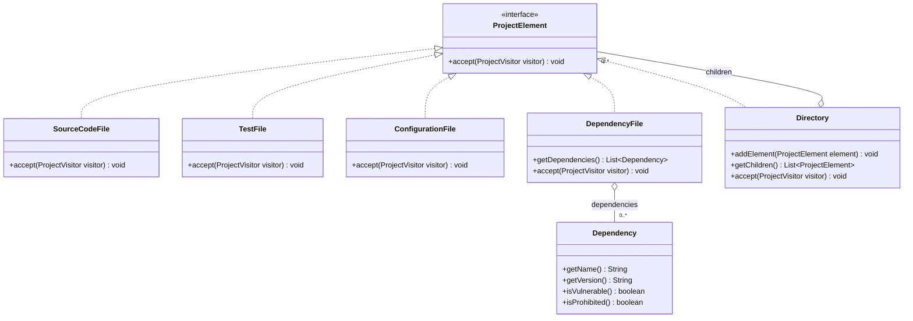
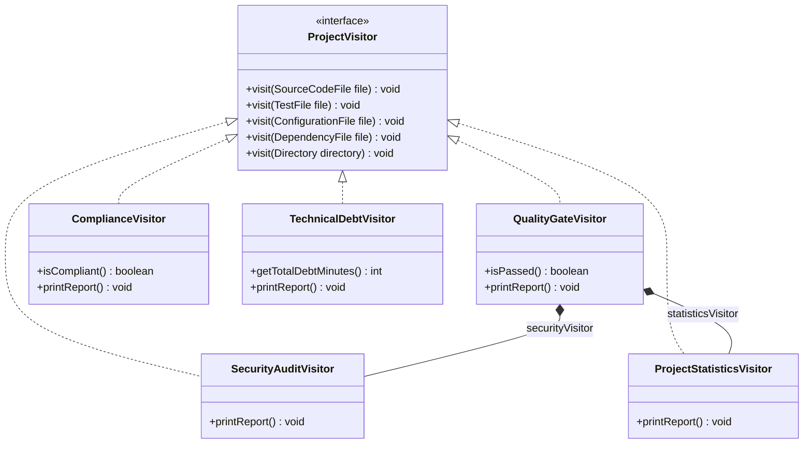
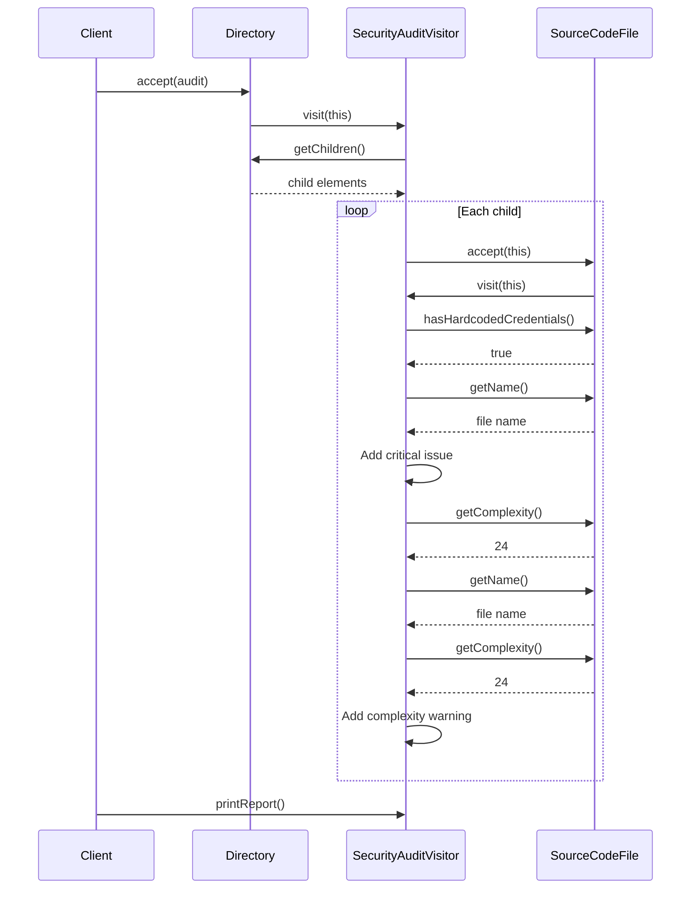

# SDP_6_assignment_Nurik

## Smart Code Inspection and Compliance Engine

A Java 17 project demonstrating the Visitor design pattern.

The application models a software project as a hierarchy of files and
directories. Separate visitors perform security auditing, statistics
collection, release quality checks, compliance checks, and technical
debt estimation.

The application analyzes an in-memory model. It does not parse actual
Java files or download dependency vulnerability information. File metrics
and security flags are supplied when the model objects are created.

## Technologies

- Java 17 or newer
- Maven
- JUnit Jupiter 5.11.4

## How to run

Open the project in IntelliJ IDEA as a Maven project and reload Maven.

Run the main method in:

`kz.nurali.inspection.InspectionDemo`

To run the tests in IntelliJ IDEA:

Maven tool window → Lifecycle → test

If Maven is installed and available in the terminal, run these commands
from the repository root:

```bash
mvn clean test
java -cp target/classes kz.nurali.inspection.InspectionDemo
```

## Project elements

All element classes implement `ProjectElement`.

| Element | Data |
|---|---|
| SourceCodeFile | Name, lines of code, complexity, credentials flag, TODO count |
| TestFile | Name, lines of code, test count, tested source file name |
| ConfigurationFile | Name, lines of code, exposed credentials and insecure settings flags |
| DependencyFile | Name, lines of code, list of dependencies |
| Directory | Name and child elements, including nested directories |

`Dependency` is a supporting data class. It stores the dependency name,
version, vulnerability flag, and prohibited-use flag.

Directories can contain any `ProjectElement`. Each visitor handles
directory traversal in its own `visit(Directory)` method.

## Visitors

### SecurityAuditVisitor

Detects:

- Hardcoded credentials in source files
- Exposed credentials in configuration files
- Insecure configuration settings
- Vulnerable dependencies
- Source files with complexity greater than 20

The first four categories produce critical issues.
High complexity produces a warning.

The illustrative security score is:

`max(0, 100 - 25 × critical issues - 10 × warnings)`

### ProjectStatisticsVisitor

Calculates:

- Total files, excluding directories
- Total lines across source, test, configuration, and dependency files
- Source file count
- Test file count
- Total individual tests
- Dependency entry count
- Average source file complexity
- Test/source file ratio

Average complexity is calculated only for source files.

The test/source ratio is the number of test files divided by the number
of source files. This is a file-count metric, not test coverage.

If there are no source files, average complexity and the test/source
ratio both return 0.0.

### QualityGateVisitor

Checks whether all release conditions are satisfied:

| Condition | Required value |
|---|---|
| Critical security issues | 0 |
| Average complexity | At most 10 |
| Test/source file ratio | At least 0.40 |

The final result is PASSED only when every condition passes.

This visitor reuses its own instances of `SecurityAuditVisitor` and
`ProjectStatisticsVisitor` instead of duplicating their calculations.

### ComplianceVisitor

Checks:

- Source files must not contain hardcoded credentials
- Configuration files must not expose credentials
- Dependency versions must not be null, empty, or blank
- Prohibited dependencies must not be used
- Every source file must have a matching test file containing at least one test

All source files in this model represent production code.

Source names and tested source names are collected during traversal.
Missing tests are determined when the report is requested, so traversal
order does not affect the result.

### TechnicalDebtVisitor

The additional visitor estimates remediation time using:

- 15 minutes per TODO
- 30 minutes per complexity point above 10, calculated per source file

This is an illustrative estimate based only on source code metrics.

It was added in a separate Git commit without changing existing element
classes or the visitor interface.

## Demonstration project

The root directory is named `fintech-project`.

| Directory | File |
|---|---|
| src | PaymentService.java |
| src | UserService.java |
| tests | PaymentServiceTest.java |
| config | application.properties |
| Project root | pom.xml |

All five visitors process the same project object.

Expected demonstration results:

| Metric | Result |
|---|---|
| Files | 5 |
| Total lines | 500 |
| Individual tests | 4 |
| Dependency entries | 2 |
| Average complexity | 16.00 |
| Test/source file ratio | 0.50 |
| Critical security issues | 3 |
| Security warnings | 1 |
| Security score | 15/100 |
| Quality Gate | FAILED |
| Compliance violations | 4 |
| Estimated technical debt | 480 minutes |

The demonstration intentionally contains violations.
FAILED in a report is an analysis result, not a program execution error.

## Tests

`InspectionVisitorsTest` contains 20 JUnit tests covering:

- Statistics across all file element types
- Nested directories
- Empty directories and division-by-zero handling
- Fractional statistics
- Security findings and the complexity threshold
- Configuration and dependency security
- The lower bound of the security score
- Quality Gate PASS at the exact thresholds
- Separate Quality Gate failures for security, complexity, and tests
- Compliance violations and repeated report access
- Tests encountered before source files
- Test files containing zero tests
- Technical debt calculations
- Rejection of negative metrics

## Design questions

### What problem does Visitor solve?

Several operations must process the same heterogeneous project structure.
Visitor separates these operations from the classes that represent files
and directories.

New analyses can be added as new visitor classes.

### Where are Element and Visitor?

`ProjectElement` is the Element interface.

`SourceCodeFile`, `TestFile`, `ConfigurationFile`, `DependencyFile`,
and `Directory` are its concrete implementations.

`ProjectVisitor` is the Visitor interface.
The five analysis classes are concrete visitors.

### What is double dispatch?

First, calling `element.accept(visitor)` selects the implementation of
`accept` according to the runtime element type.

Inside that implementation, `visitor.visit(this)` selects the overload
for the concrete element type. The visitor object's runtime type then
determines which visitor implementation executes that method.

The resulting behavior therefore depends on both the element type
and the visitor type.

### Why not put all operations inside element classes?

Doing so would mix file data with security rules, statistics,
compliance rules, and release decisions.

Every new operation would require editing multiple element classes.
Visitors keep related analysis logic together.

### Is adding a Visitor or an Element easier?

Adding a visitor is easier when the element hierarchy is stable.

A new visitor implements the existing visit methods.
Existing element classes remain unchanged.

Adding a new element requires updating the visitor contract and every
concrete visitor.

### What happens when DatabaseMigrationFile is added?

The following changes are needed:

1. Create `DatabaseMigrationFile implements ProjectElement`.
2. Implement its `accept(ProjectVisitor visitor)` method.
3. Add `visit(DatabaseMigrationFile file)` to `ProjectVisitor`.
4. Implement that overload in every concrete visitor.
5. Update the demonstration, tests, and diagrams as appropriate.

Without the new overload, `visitor.visit(this)` in the new element cannot
resolve a matching visit method.

After adding the abstract overload to the interface, existing concrete
visitors will fail to compile until they implement it.

The existing concrete element classes do not need to change.

### When would Visitor be a bad choice?

Visitor is inconvenient when new element types are added frequently,
because each addition affects every visitor.

It can also be unnecessary for a small model with only one simple operation.

### How is Visitor different from Strategy?

Strategy provides interchangeable algorithms for a particular task.

Visitor defines an operation across several concrete element types and
uses their accept/visit interaction to select type-specific behavior.

### Which SOLID principles are visible?

- Single Responsibility: elements hold project data; visitors implement
  separate analyses.
- Open/Closed: new operations can be added without changing existing
  elements. Adding new element types still requires changing the visitor
  interface and implementations.
- Dependency Inversion: elements accept the `ProjectVisitor` abstraction
  instead of depending on a specific analysis class. The visitor contract
  still explicitly references concrete element types.

## Class diagrams

The diagrams below show the element hierarchy and visitor hierarchy
as two views of the same implementation.

### Element hierarchy



### Visitor hierarchy and dispatch



Each concrete element implements `accept` by calling
`visitor.visit(this)`. The overloads in `ProjectVisitor` correspond to
the five concrete element classes.

## Sequence diagram

This example shows a security visitor processing a directory containing
one source file with hardcoded credentials and complexity 24.



## Model assumptions

- Create a fresh visitor instance for each independent analysis.
  Visitors accumulate results during traversal.
- Source identifiers must be unique within the analyzed project.
  Use unique names or project-relative paths, and use matching values
  in `TestFile.testedSourceFile`.
- The directory structure must be acyclic. Direct self-insertion is
  rejected, but indirect directory cycles are not detected.